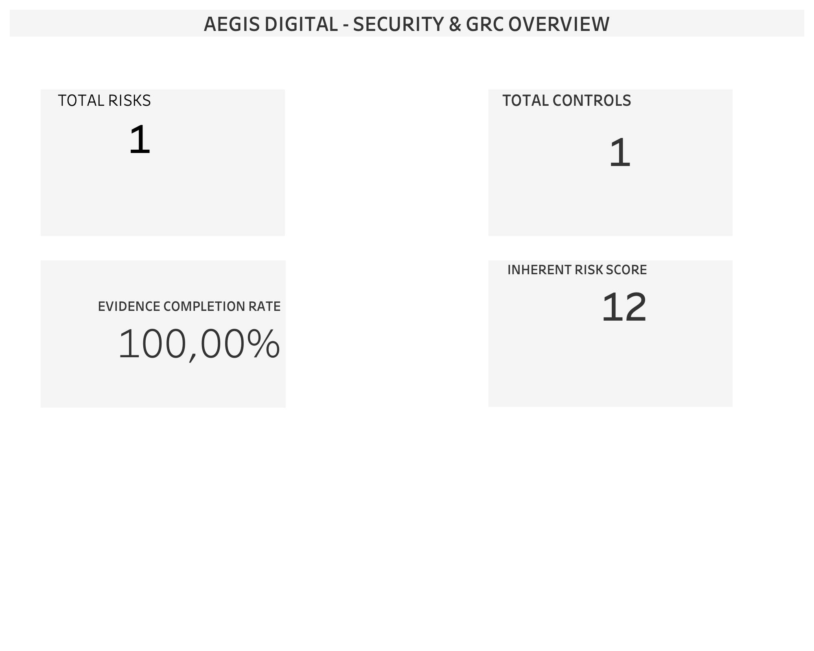

# Aegis Digital | Security Governance & GRC

**Independent Portfolio Project | November 2026**

**Focus:** Security Governance · Risk Assessment · Internal Controls · Audit Evidence · Remediation Tracking

**Tools:** Microsoft Excel · PostgreSQL / SQL · Tableau · Jira · Confluence

---

## Project Overview

Aegis Digital is a simulated enterprise Security Governance, Risk and Compliance (GRC) project designed to demonstrate how cybersecurity risks, internal controls, audit evidence and remediation activities can be managed through an integrated governance workflow.

The project combines structured documentation, SQL-based analysis, interactive reporting and operational issue tracking.

All data is synthetic and used for learning and portfolio purposes.

## GRC Dashboard

The Tableau dashboard presents four key performance indicators from the initial assessment.

| KPI | Result |
|---|---|
| Total Risks | 1 |
| Total Controls | 1 |
| Evidence Completion Rate | 100% |
| Inherent Risk Score | 12 |

**Interpretation:** The evidence completion rate measures evidence requests marked as received. It does not confirm evidence approval or full control effectiveness.

## Tools & Methodology

### Microsoft Excel
Developed structured registers for cybersecurity risks, access reviews, control assessments, audit evidence and remediation activities.

### PostgreSQL / SQL
Used relational queries, joins, aggregations and KPI calculations to analyze risk, control and evidence records.

### Tableau
Designed a management dashboard to summarize key GRC indicators and communicate assessment results.

### Jira
Created and tracked operational tasks related to security control verification and access management.

### Confluence
Documented the governance framework, risk and control assessments, evidence verification process, remediation workflow and executive findings.

## Key Findings

**R001 — Cloud Access Risk**

A simulated cybersecurity risk involving potential unauthorized access to cloud-based documents was recorded with an inherent risk score of 12.

**C001 — Control Effectiveness**

The Periodic User Access Review control was assessed as Partially Effective.

**EV-001 — Evidence Management**

The evidence request was marked as Received, while the control-level evidence status remained Pending. This inconsistency requires reconciliation.

**Remediation Tracking**

Jira issue KAN-4 tracks verification activities related to cloud access permissions and multi-factor authentication. The issue remained In Progress at the time of the assessment.

## Recommendations

1. Verify the completeness and relevance of audit evidence.
2. Reconcile inconsistent evidence status records.
3. Review cloud access permissions and MFA coverage.
4. Document confirmed control weaknesses and corrective actions.
5. Update governance records after verification.

## Project Deliverables

The repository contains:

- Excel-based GRC registers
- PostgreSQL / SQL analysis scripts
- Synthetic assessment dataset
- Tableau dashboard workbook and PNG preview
- Jira issue export
- Confluence governance documentation

## Skills Demonstrated

Risk Assessment · Security Governance · Control Monitoring · Evidence Management · SQL Analytics · KPI Reporting · Jira Workflow Management · Governance Documentation

## Project Limitations

This is an independent educational portfolio project based on a limited synthetic dataset.

The assessment does not establish the security or compliance status of a real organization. Proposed corrective actions must not be interpreted as completed remediation.

---

**Author:** Marilena Blanchi

**Project Type:** Independent Security Governance & GRC Portfolio Case Study
